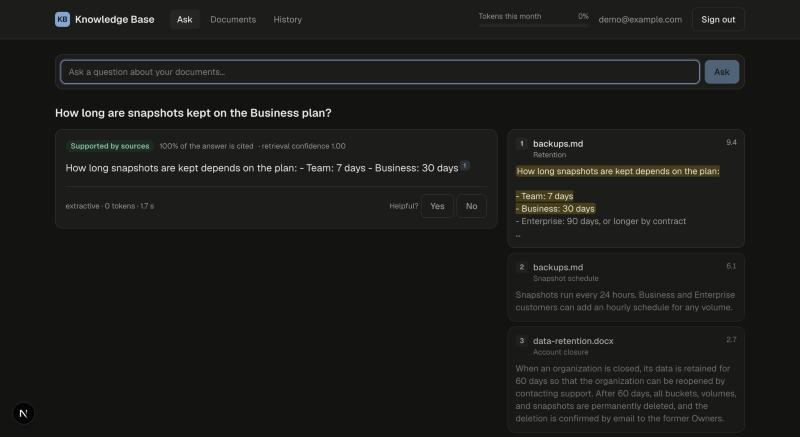
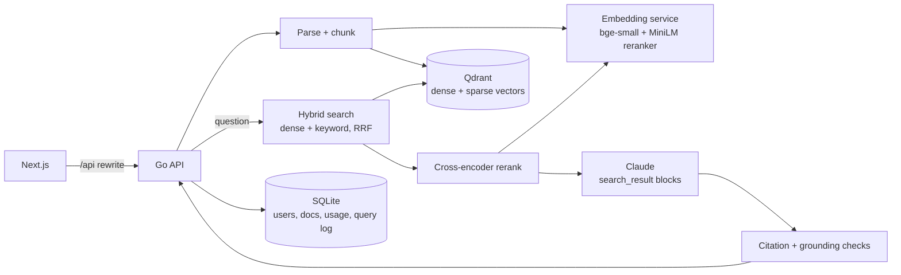

# RAG Knowledge Base

[](https://github.com/kuini-1/rag-knowledge-base/actions/workflows/ci.yml)

Upload PDF, Word, Markdown and text files, then ask questions about them. Every answer cites the passages it used, and each answer is checked against its sources before it is shown: quotes must match, claims without a citation and numbers that appear in no source are flagged.

Go API, Next.js frontend, Qdrant for vectors, sentence-transformers for embeddings and reranking, Claude for answers.



**Live demo:** not deployed yet (see [Running it](#running-it)).

## What it does

- **Parsing:** PDF, DOCX, Markdown and plain text. Headings, paragraphs, lists and tables are kept as structure, and every block remembers where it sits in the source.
- **Chunking you can tune:** fixed windows or structure-aware chunks, with configurable size and overlap. Tables are split by row with the header repeated, and a "title > section" header can be added to each chunk.
- **Retrieval:** hybrid search (dense vectors plus BM25-style keyword vectors, fused with reciprocal rank fusion), then a cross-encoder reranker.
- **Cited answers:** chunks go to Claude as `search_result` blocks, so every citation points to an exact chunk and quote.
- **Hallucination checks on every answer:** each quote must appear in the chunk it cites. Uncited statements and numbers found in no source are flagged, and weak retrieval lowers the rating. The result is a low / medium / high risk label with reasons.
- **Accounts and limits:** email and password (bcrypt), signed sessions, per-user and per-IP rate limits, and a monthly token budget per user. Each user only ever searches their own documents.
- **Evaluation:** a 71-question test set, retrieval metrics by source position, a chunking and retrieval ablation, an LLM-judged answer evaluation, and a log of every retrieval miss.
- **Production feedback loop:** every question is logged. Answers that were flagged, retrieved weakly or marked unhelpful land in a review list.

## Architecture



## Results: chunking and retrieval ablation

All numbers come from `make ablation` on a laptop CPU (full output in [`eval/results/ablation.md`](eval/results/ablation.md), every miss in [`bad_retrievals.jsonl`](eval/results/bad_retrievals.jsonl)). No LLM is involved.

**How it's scored.** Each of the 64 answerable questions records the exact passage that answers it. A retrieved chunk counts as a hit when its source range covers at least 80% of that passage. Scoring by position in the source, not by chunk text, is what makes chunking configs comparable: a chunk with an added context header or a repeated table header is judged on the source text it came from. Hit@k is the share of questions with a hit in the top k; MRR is the mean of 1/rank of the first hit in the top 10.

### Chunking (dense search only, so only the chunking changes)

| Config | Chunks | Hit@1 | Hit@5 | MRR | Prompt tokens for top 5 |
|---|---|---|---|---|---|
| fixed 64 tokens | 104 | 62% | 77% | 0.690 | 315 |
| fixed 128 | 55 | 61% | 88% | 0.725 | 605 |
| fixed 256 | 31 | 66% | 92% | 0.762 | 1,032 |
| fixed 512 | 16 | 72% | 92% | 0.810 | 1,946 |
| fixed 128, overlap 32 | 65 | 70% | 94% | 0.799 | 608 |
| structure 128 | 94 | **77%** | 92% | 0.840 | 320 |
| structure 128 + context header | 94 | 75% | **97%** | **0.850** | 366 |
| structure 256, overlap 32 + header (default) | 90 | 73% | 95% | 0.835 | 386 |

- **Structure beats size.** Structure-aware chunks reach a better Hit@1 than any fixed window while putting a third as many tokens in the prompt as fixed-256.
- **Overlap helps fixed windows** (fixed-128: Hit@5 88% → 94%) by keeping facts that straddle a boundary in at least one chunk.
- **Size barely matters for structure chunks on this corpus.** Sections are short, so headings decide most boundaries: 128, 256 and 512 give 94, 90 and 89 chunks.

### Retrieval (on the default chunking)

| Setup | Hit@1 | Hit@3 | Hit@5 | MRR | Latency p50 (two runs) |
|---|---|---|---|---|---|
| dense | 73% | 94% | 95% | 0.835 | 52-70 ms |
| hybrid (dense + keyword, RRF) | 84% | 97% | **100%** | 0.905 | 74-75 ms |
| dense + cross-encoder rerank | **94%** | 98% | 98% | **0.961** | 1.3-1.9 s |
| hybrid + rerank (default) | **94%** | 98% | 98% | **0.961** | 1.4-1.5 s |

- **Hybrid search is the cheapest win:** +11 points of Hit@1 and every answer in the top 5, for about 5-20 ms more.
- **Reranking fixes ranking:** Hit@1 goes from 73% to 94%, at the cost of 1.3-1.9 s on a laptop CPU (a GPU or a smaller candidate set would cut this).
- **With reranking, hybrid adds nothing measurable here.** On 15 documents, dense search already puts every useful chunk into the 30 rerank candidates. It stays on by default because on a large corpus an exact identifier can fall outside the dense top 30, and keyword search is what brings it back. That reasoning is not measured by this corpus.

Two consecutive runs of the final code give the same numbers on every metric but one: hybrid Hit@3 is 95% in one run and 97% in the other, because a single question moved between rank 3 and 4. The tables show the second run, which is the one in `eval/results`. Latency varies more, since it's wall-clock time on a laptop. Getting runs to repeat took two fixes, listed under failure modes below.

## Retrieval failure modes found and fixed

Each case comes from the miss log, with the setup that fixed it.

1. **Tables cut away from their header.** With 64-token fixed windows, 15 of 64 questions had no hit in the top 5, including "How much does the Team plan cost?" and "What does LS-3012 mean?": the row landed in a chunk without the column names. *Fix:* structure-aware chunking that splits tables by row and repeats the header row in every piece. Every table question now has a hit in the top 5.
2. **Sections that never name their subject.** The SLA says "This plan commits to 99.95%" under a "Business" heading. Without the heading, "What uptime does the Business plan guarantee?" wasn't retrieved at all. *Fix:* prefix each chunk with its path ("Service Level Agreement > Uptime commitments > Business"). Hit@5 went from 92% to 97%. Trade-off: Hit@1 dipped 2 points, because sibling chunks now share words.
3. **Exact identifiers.** Dense search ranked the chunk containing `INC-2025-0814` 7th and put only 56% of identifier questions first. *Fix:* keyword vectors whose tokenizer keeps `LS-3012`, `ap-bangkok-1` and `X-Larkspur-Signature` whole (and also indexes their parts), fused with RRF. Identifier Hit@1 rose to 89% (100% with reranking).
4. **Right document, wrong rank.** Dense search put the answer first only 73% of the time. PDF questions were worst (33%); all three come from one incident report whose sections share most of their vocabulary. *Fix:* a cross-encoder reranker over 30 candidates. Hit@1 rose to 94%, and PDF questions to 100%.
5. **Benchmarks that didn't repeat.** Repeated runs gave hybrid Hit@1 of 80%, 83% and 84%. Qdrant's server-side fusion left score ties in no fixed order, and a collection can still be updating its statistics right after a bulk load. *Fix:* fuse the dense and keyword lists in Go with a fixed tie-break (best single rank, then id), and wait for the collection to report ready before measuring.

Still open:

- **Vocabulary mismatch.** "What happens when a free-tier account runs out of storage?" fails with reranking, because the documents call it the Starter plan and never say "free tier". Hybrid search alone has it in the top 5, but the reranker pushes it out of the top 10. Query rewriting with the LLM, or a synonym list, would likely help; neither is built.
- **Outdated figures.** The changelog says the Team limit was raised "from 600 to 1,200", which competes with the current table. Questions where a current and an outdated value both appear (tagged `distractor`) reach only 67% Hit@1 in every setup. The answer prompt tells Claude to prefer the current value and mention the change. Marking superseded passages in metadata would be the retrieval-side fix.

## Citation validation

Every answer goes through `answer.Validate` before it is returned:

1. **Quotes are checked.** Each citation carries the text Claude quoted and the index of the chunk it came from. The quote must appear in that chunk, ignoring whitespace. A citation that fails is shown in red and makes the answer high risk.
2. **Uncited statements are flagged.** The answer arrives as text segments, each with or without citations. Uncited segments that state something (six or more words, or any number) count as unsupported claims. Short connectives like "Yes," don't count.
3. **Numbers are checked against the sources.** Every number in the answer must appear in at least one retrieved chunk, with thousands separators normalised. A wrong figure is the most damaging kind of hallucination in documentation Q&A, and it's cheap to catch.
4. **Retrieval confidence is reported.** The reranker's top score becomes a 0-1 confidence. Below 0.2, the answer is flagged: the documents probably don't cover the question.
5. **Abstentions are recognised.** The prompt tells Claude to say "I couldn't find this in your documents" rather than guess, and that answer is treated as low risk.

The checks are deterministic and cost nothing, so they run on every request, not only during evaluation.

## Answer quality

`make eval` runs the whole pipeline on all 71 questions and grades the answers. It needs a Claude API key, and it **hasn't been run yet** for this README, so there are no answer-quality numbers here. It reports:

- **Accuracy** on the 64 answerable questions. Claude grades each answer against the reference as correct, partial or incorrect, using structured outputs so the verdict is machine-readable. Partial counts as half.
- **False abstentions**: "couldn't find it" when the answer was in the documents.
- **Correct abstentions** on the 7 unanswerable questions. Two of them are near-misses: GPU virtual machines (the docs only mention GPU image processing) and an SLA for the database add-on (the docs only cover the storage SLA).
- **Citation precision** (quotes found verbatim in their source), **share of cited text**, and the **risk label distribution** from the validator.

Results go to `eval/results/answers.md`, with every failure listed. That's about 140 API calls; at `claude-opus-5-5` list prices it should cost roughly $1-3, depending on how much the model thinks.

LLM-as-judge has known limits. The judge can be lenient with hedged answers, it never sees the source documents (only the reference answer), and a judge from the same model family may share its blind spots. The deterministic checks (abstentions, citation precision, unsourced numbers) don't depend on the judge, which is why they are reported separately.

## Running it

**Docker Compose** (everything, including the models):

```bash
cp .env.example .env        # set ANTHROPIC_API_KEY and RAG_JWT_SECRET
docker compose up --build   # then open http://localhost:3000
```

Without an API key, set `RAG_ANSWER_MODE=extractive`. Answers are then the best-matching source sentence, cited, with no model call.

**Locally:**

```bash
make services                 # Qdrant in Docker
make embedder                 # embedding service on :8001 (Python venv)
export ANTHROPIC_API_KEY=...  RAG_JWT_SECRET=$(openssl rand -hex 32)
make build && ./bin/ragd serve
cd web && npm install && npm run dev   # http://localhost:3000
```

The first account you register becomes the admin. Set `RAG_ALLOW_SIGNUP=false` to close sign-up after that, and create users with `RAG_NEW_PASSWORD=... ./bin/ragd user add -email someone@example.com`.

## API

| Method | Path | Purpose |
|---|---|---|
| `POST` | `/api/auth/register` | `{"email", "password"}`: create an account, returns a session token |
| `POST` | `/api/auth/login` | Same body, returns a session token |
| `GET` | `/api/me` | The user and this month's token usage |
| `POST` | `/api/documents` | Multipart upload, field `file`, up to 5 files of 20 MB |
| `GET` | `/api/documents` | Documents with indexing status |
| `DELETE` | `/api/documents/{id}` | Delete a document and its chunks |
| `POST` | `/api/ask` | `{"question"}`: a cited, checked answer |
| `GET` | `/api/queries?flagged=1` | Query log; `flagged=1` keeps the ones worth reviewing |
| `POST` | `/api/queries/{id}/feedback` | `{"helpful": false}` |
| `PATCH` | `/api/admin/users/{id}` | Admin only: `{"token_budget": 500000}` |

Shape of a `POST /api/ask` response (shortened, values illustrative):

```json
{
  "query_id": "q_0b1d9c2e",
  "text": "The Team plan allows 1,200 requests per minute, up from 600 before June 2025.",
  "segments": [
    {"text": "The Team plan allows 1,200 requests per minute",
     "citations": [{"index": 0, "doc_name": "api-rate-limits.md", "cited_text": "| Team | 1,200 | 200 | 16 |", "verified": true}]}
  ],
  "sources": [{"rank": 1, "rerank_score": 7.4, "payload": {"doc_name": "api-rate-limits.md", "section": ["API Rate Limits", "Limits by plan"]}}],
  "check": {"grounded": 0.92, "unsourced_numbers": [], "retrieval_confidence": 1.0, "hallucination_risk": "low", "warnings": []},
  "usage": {"model": "claude-opus-5-5", "input_tokens": 1830, "output_tokens": 74},
  "month_usage": {"month": "2026-11", "tokens": 5210, "requests": 3, "budget": 200000}
}
```

Errors are `{"error": "..."}`. 429 responses carry `Retry-After`, and a used-up budget returns 429 with the reset date.

## Tests

```bash
make test          # unit tests: parsers, chunking, citation checks, eval logic
make integration   # API end to end against real Qdrant and embeddings (Claude is faked)
make ablation      # retrieval study, no LLM calls
make eval          # answer quality, calls the Claude API
```

The integration test covers sign-up, login, upload and indexing, a cited answer, isolation between users, admin-only routes, budget enforcement, rate limiting, feedback and deletion.

## Model providers and licenses

- Answers: Anthropic Claude through the official Go SDK, `claude-opus-5-5` by default, with server-side refusal fallbacks on. Usage is billed to your Anthropic account under Anthropic's commercial terms.
- Embeddings: [`BAAI/bge-small-en-v1.5`](https://huggingface.co/BAAI/bge-small-en-v1.5) (MIT). Reranker: [`cross-encoder/ms-marco-MiniLM-L-6-v2`](https://huggingface.co/cross-encoder/ms-marco-MiniLM-L-6-v2) (Apache 2.0). Both run locally on CPU.
- The evaluation corpus describes a fictional company, Larkspur Cloud, and was written for this project.

## Limitations

- The evaluation corpus is small (15 documents). It was built to contain known hard cases, so the numbers show relative differences between setups, not expected accuracy on your documents.
- Scanned PDFs need OCR, which isn't included.
- Session tokens live in the browser's local storage. An httpOnly cookie would be safer against XSS.
- Rate limits live in memory, so they only hold within one API instance.

## Lessons learned

- **Score retrieval against the source, not the chunk.** Matching the expected passage by position in the document is what allowed twelve chunking configs to be compared fairly, including ones that add headers or repeat table rows.
- **Check run-to-run variance before trusting a 2-point gain.** Repeated runs first differed by up to 4 points of Hit@1, which is bigger than several of the effects being measured.
- **A reranker is not strictly better.** It raised Hit@1 by 21 points but also pushed one correct answer out of the top 10. It only sees the question and the passage, so it can't bridge a synonym the documents never use.
- **Structure matters more than size.** On documents with short sections, heading boundaries and keeping table rows with their header did more than any size setting.
- **Deterministic checks are worth running on every answer.** Verifying quotes and numbers costs nothing and catches the failures users notice most: a confident answer with a wrong figure.
